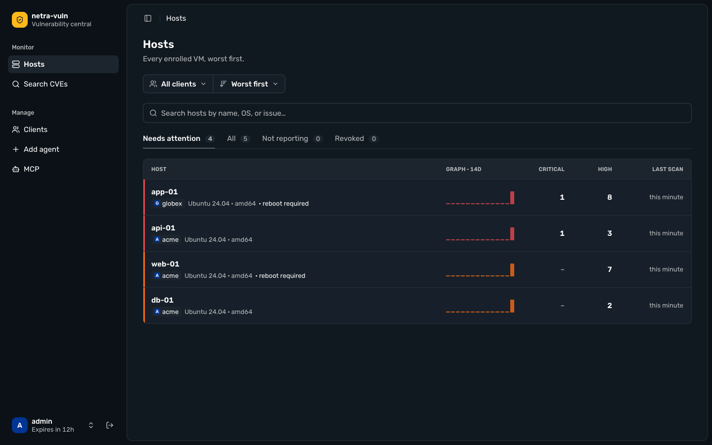
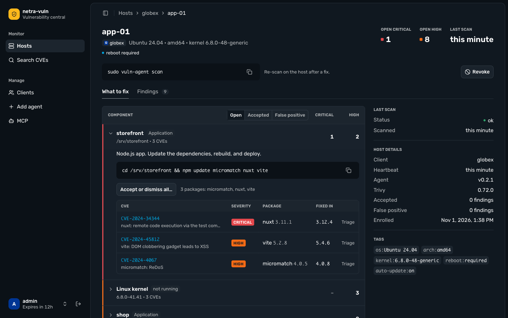
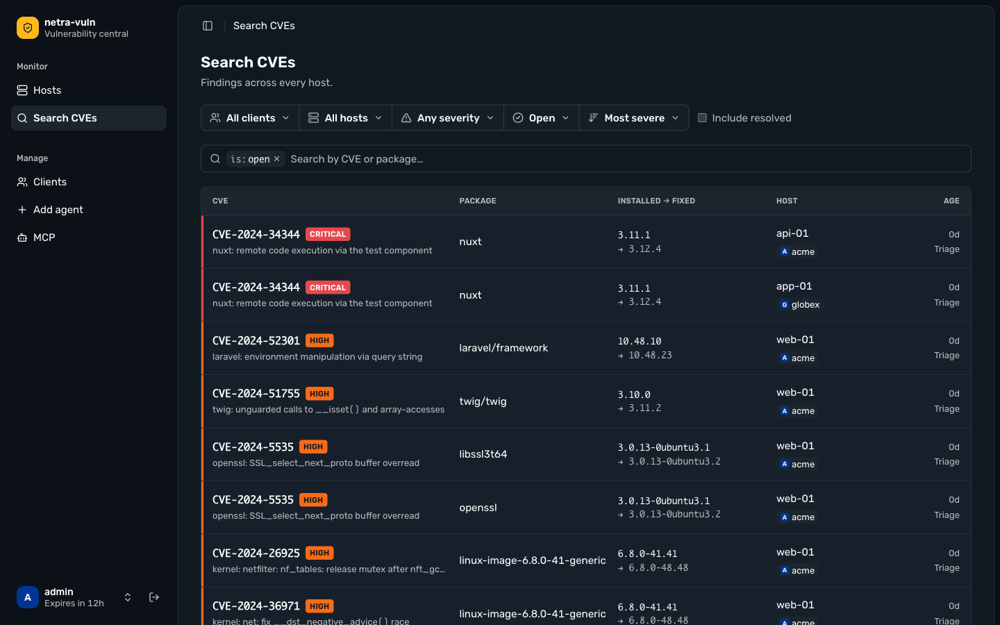
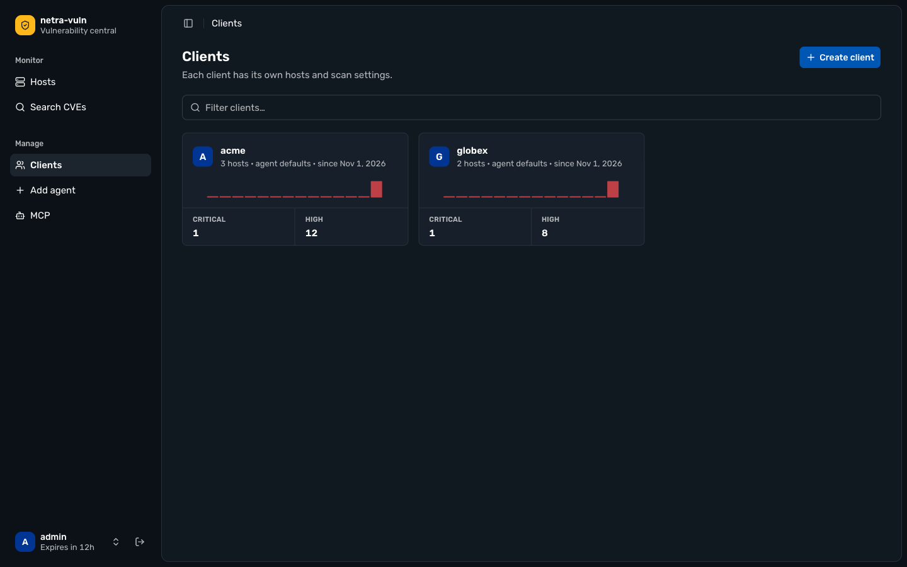
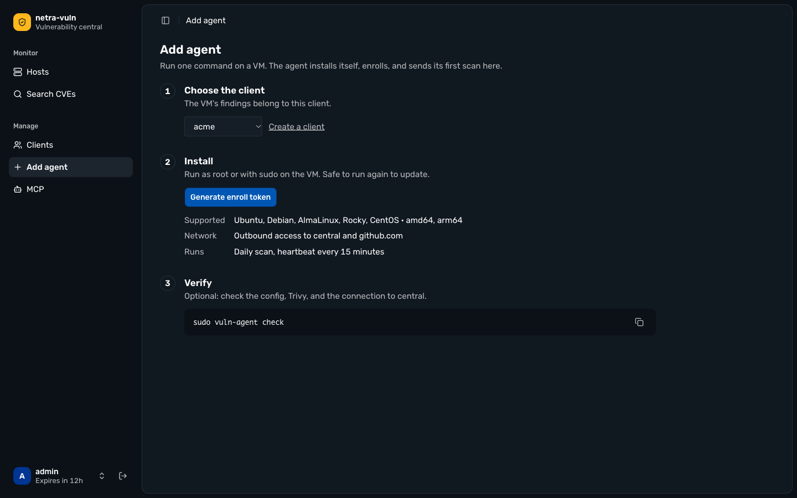

# netra-vuln

Central vulnerability monitoring for a fleet of Linux VMs across several clients.
A small agent ([netra-vuln-agent](https://github.com/idnatiya/netra-vuln-agent)) runs
[Trivy](https://trivy.dev) on each VM and pushes the slimmed-down results here; central
stores them in SQLite and shows them in an admin dashboard: what is vulnerable, on which
host, and the exact command to fix it.



| What to fix, per host | Search CVEs across hosts |
| --- | --- |
|  |  |
| **Clients** | **Add agent (one-line installer)** |
|  |  |

## Features

- **Hosts** sorted worst first, with 14-day trends, stale/not-reporting detection, reboot and auto-update hints.
- **What to fix**: findings grouped into one upgrade action each (an OS source package, the
  Linux kernel, an application folder, or a binary) with a copy-ready command
  (`apt`/`dnf`, kernel purge vs. upgrade + reboot, `composer`/`npm`/`pip`, `dpkg -S`/`rpm -qf`).
- **Triage**: mark a finding or a whole component *accepted* or *false positive*, with an optional note; verdicts survive re-scans.
- **End of life**: OS, PHP, Node.js, nginx, Apache, MySQL/MariaDB, Redis, PostgreSQL, and frameworks
  (Laravel, Symfony, Nuxt, Vue, Next, React, Angular) are checked against [endoflife.date](https://endoflife.date),
  separate from CVEs; EOL software shows as a host issue and on the host's Software tab.
- **Multi-tenant**: every host belongs to a client; a client's tokens can never read or write another client's data.
- **Per-client scan config**: severities, ignore-unfixed, skip dirs, timeout.
- **MCP server** (`/mcp`) so AI clients (Claude Code, Codex, Cursor, ...) can query findings; triage is opt-in per token.

## Architecture

```
  VM (per client)                          your HTTPS             central (Docker Compose)
 ┌──────────────────┐  HTTPS push only   ┌──────────────┐    ┌─────────────────────┐    ┌───────┐
 │ vuln-agent       │ ─────────────────▶ │ reverse      │ ─▶ │ central (Go, Fiber) │ ─▶ │SQLite │
 │  + Trivy (daily) │ enroll / heartbeat │ proxy        │    │  API + dashboard    │    └───────┘
 └──────────────────┘  config / report   │ (nginx,      │    │  SPA (Vue)          │        │
  admin browser ───────────────────────▶ │  Traefik,    │    └─────────────────────┘        ▼
  AI client (MCP) ─────────────────────▶ │  tailscale…) │                              daily backup
                                         └──────────────┘
```

- **Passive agent**: it only sends data and reads declarative config. Central cannot run commands on a VM.
- **Push only**: VMs connect to central; central never connects to a VM. VMs never touch the database.
- **Tokens hashed** (SHA-256): single-use enroll tokens bound to a client, one revocable token per host.
- Plain HTTP between agent and central is allowed only over an encrypted network such as Tailscale.

## Deploy central

Requirements: a Linux server with Docker Compose, and an HTTPS reverse proxy you already run
(nginx, Traefik, Cloudflare Tunnel, `tailscale serve`, ...). The dashboard needs HTTPS: the session cookie is `Secure`.

```sh
cp .env.example .env        # set CENTRAL_PUBLIC_URL
docker compose up -d --build
docker compose exec central central admin create <name>   # first admin (prompts for a password)
```

Central (API and dashboard) listens on `CENTRAL_PORT` (default `127.0.0.1:8080`). Point the proxy at it,
for example with nginx:

```nginx
location / {
    proxy_pass http://127.0.0.1:8080;
    proxy_set_header Host $host;
    proxy_set_header X-Forwarded-For $remote_addr;
    client_max_body_size 25m;   # reports are up to 20 MB
}
```

Open `CENTRAL_PUBLIC_URL` and sign in. Useful `.env` settings:

| Variable | Purpose |
| --- | --- |
| `CENTRAL_PUBLIC_URL` | URL VMs and browsers use to reach central (the proxy's URL) |
| `CENTRAL_PORT` | Host address central listens on; keep it on 127.0.0.1 or a private interface |
| `ADMIN_ALLOW_CIDRS` | Networks allowed to reach the dashboard, admin API and `/mcp` (agents are never restricted) |
| `CENTRAL_AGENT_VERSION` | Agent release served by the one-line installer (`/install.sh`); empty disables it |
| `BACKUP_AT`, `BACKUP_KEEP_DAYS` | Daily database copy into the volume's `/data/backups` (copy out: `docker compose cp central:/data/backups ./backups`) |

The proxy must send `Host` unchanged (the admin API checks a same-origin `Origin`) and `X-Forwarded-For`
(client IPs for the login limit and `ADMIN_ALLOW_CIDRS`; trusted only from private/loopback addresses).
Migrations run automatically when central starts. Manual backup: `docker compose exec central central backup /data/backups/now.db`. More admins: `docker compose exec central central admin create|passwd|list`.

## Enroll a VM

1. **Clients** → create a client (e.g. `acme`).
2. **Add agent** → pick the client → **Generate enroll token** → run the command on the VM as root.
   The token enrolls exactly one agent. Supported: Ubuntu, Debian, AlmaLinux, Rocky, CentOS (amd64, arm64).
3. Optional: `sudo vuln-agent check` on the VM.

The agent scans daily and sends a heartbeat every 15 minutes. After fixing something, re-scan with
`sudo vuln-agent scan`. Manual install, Ansible role and agent configuration are documented in the
[agent repo](https://github.com/idnatiya/netra-vuln-agent).

## Revoke or delete a host

- Dashboard: host page → **Revoke**. The host token stops working immediately; history is kept.
- CLI: `docker compose exec central central host revoke <hostname> -client <name>`.
- A revoked host can be **deleted** from its page (permanently removes its scans and findings).
  The agent stays installed on the VM; uninstall it there.
- To bring a revoked host back, issue a new enroll token and enroll again: it reuses the same host row.

## MCP for AI clients

**MCP** page → create a token (shown once) → copy the setup for your client (Claude Code, Codex,
OpenCode, Antigravity, Cursor, Claude Desktop). Tools: `list_clients`, `list_hosts`, `search_findings`,
`host_components`; tokens created with **Allow triage** also get `triage_finding` and `triage_component`
(notes are tagged `[via MCP: <token name>]`). Central makes no LLM calls itself.

## Telegram

1. Create a bot with @BotFather, put its token in `.env` as `TELEGRAM_BOT_TOKEN`, then
   `docker compose up -d central`.
2. Send `/start` to the bot (or add it to a group). It replies with the chat id.
3. `docker compose exec central central telegram add-chat <chat_id>` for an admin chat (all clients),
   or add `-client <name>` for a chat that sees one client only. `central telegram test` checks delivery.

Alerts: new critical/high per scan, host not reporting / recovered, 3 failed scans in a row, software
reaching end of life, and a daily summary at `TELEGRAM_DIGEST_AT` (UTC). Commands (read-only):
`/status`, `/hosts [client]`, `/host <hostname>`, `/cve <id>`. Central polls the Bot API; nothing needs to reach central.

## Local development

```sh
make dev     # central (:18080, SQLite in dev-out/) + dashboard (http://localhost:11270)
make test    # dashboard tests + go vet + Go tests (temp SQLite, no Docker)
make help    # all targets
```

`make dev` seeds admin `admin` (password in `dev-out/admin-password`). Admin CLI on the dev DB:
`make central ARGS="client list"`. Layout: `core/` (Go API, migrations, black-box tests in `core/test`),
`dashboard/` (Vue 3 + shadcn-vue), `Dockerfile` / `docker-compose.yml` (production: one container, SQLite on a volume).

## Security and data retention

- Central stores, per host: OS/kernel/agent metadata, heartbeats, scan summaries and findings
  (CVE, package, versions, file path of the lockfile or binary). No file contents, secrets or configs.
- Findings are never deleted by scans: fixed ones get `resolved_at`, triage is kept. Data is removed
  only by deleting a revoked host. Backups follow `BACKUP_KEEP_DAYS`.
- Admin sessions: HttpOnly/Secure/SameSite=Strict cookie, 12 h, CSRF check on same origin, login rate limit.
- What the agent reads and sends is documented in the agent repo.

## Troubleshooting

| Symptom | Fix |
| --- | --- |
| Report rejected as too large (413 / connection reset) | The body limit is 20 MB decompressed. Narrow `app_dirs` on the VM or add skip dirs in the client's scan config. |
| Enroll returns 409 | The hostname is already active for that client. Revoke it first, then enroll with a new token. |
| Enroll returns 401 | Unknown client, or the enroll token was already used, belongs to another client, or is wrong. Generate a new one. |
| Host shows "not reporting" | No heartbeat for over an hour: check `systemctl status vuln-agent-*` and network access to central. |
| Dashboard 403 | Your IP is outside `ADMIN_ALLOW_CIDRS` (or the proxy does not send `X-Forwarded-For`). |
| Login succeeds but you stay on the login page | The dashboard is served over plain HTTP; the `Secure` session cookie needs HTTPS. |
